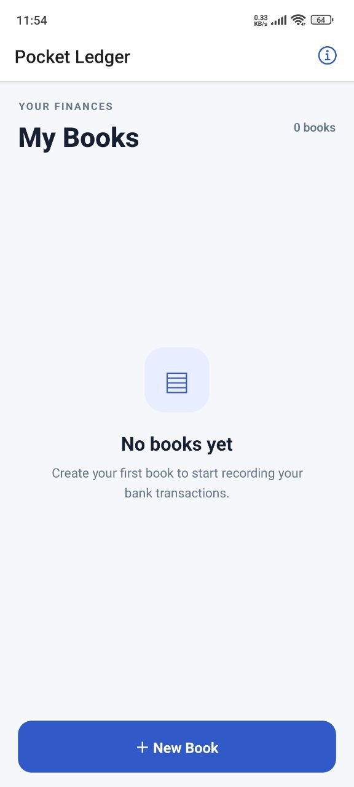
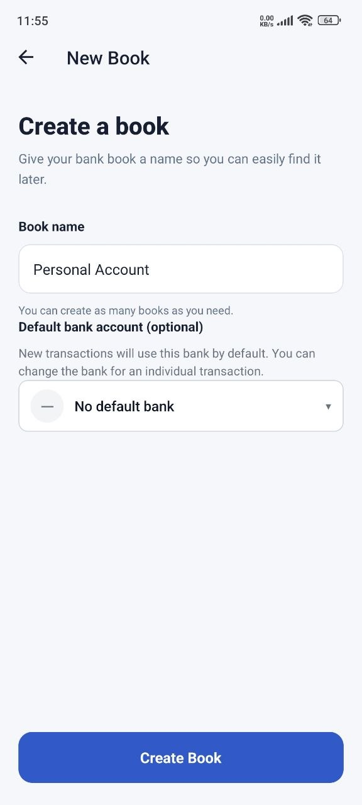
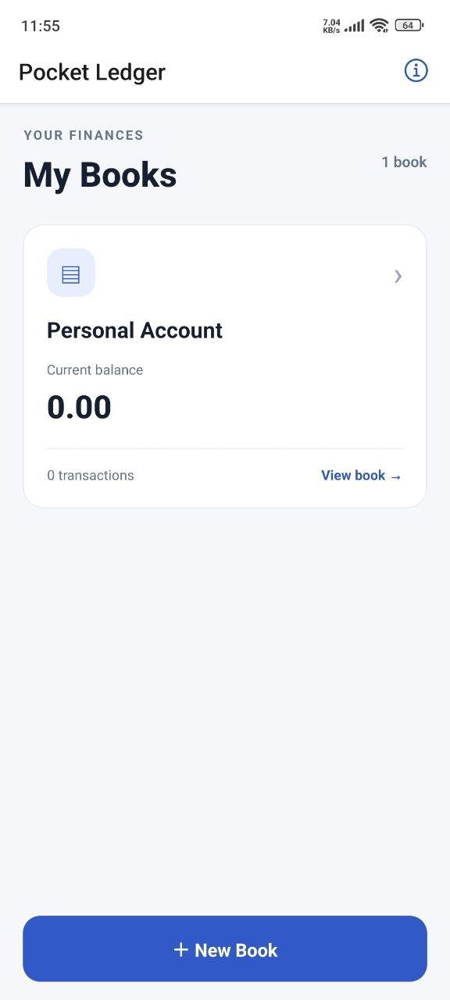
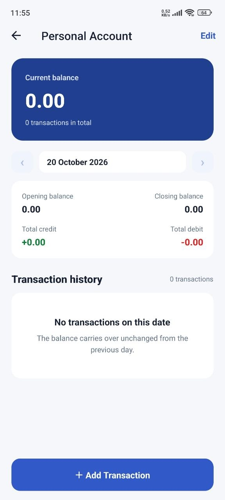
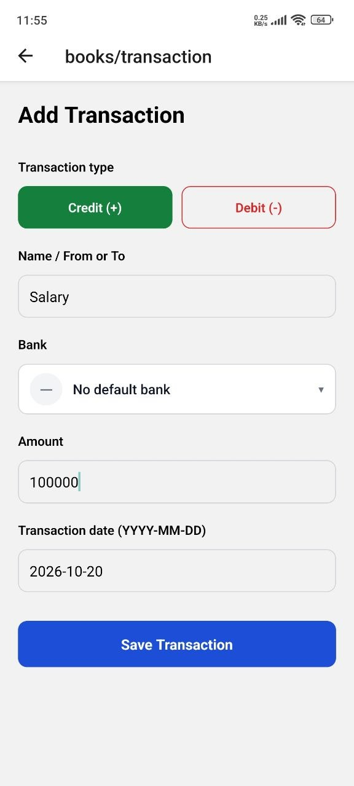
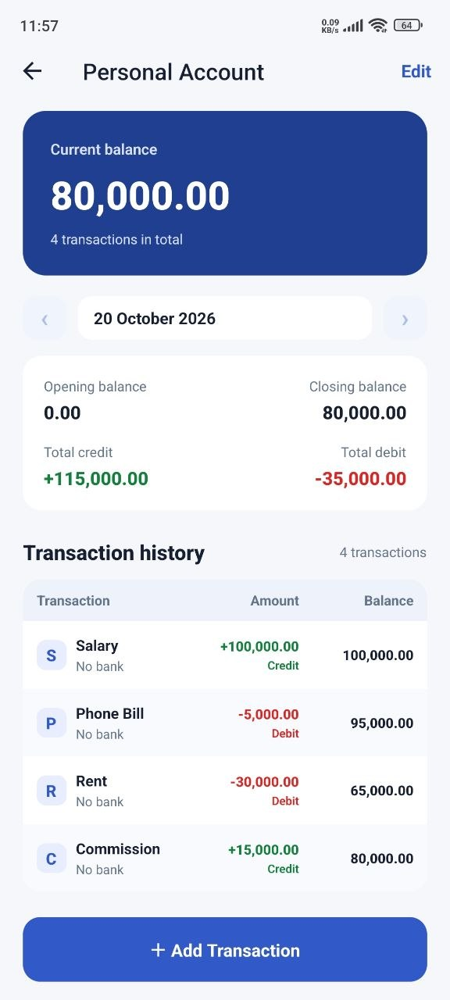

# Pocket Ledger

A simple, offline-first bank book app for keeping track of the money moving through your bank accounts and mobile wallets. Create a book for each account, record credits and debits, and browse a clean day-by-day statement with opening, closing and running balances.

Built with React Native, Expo and SQLite. Everything is stored locally on your device. There is no account to create and no server involved.

## Download

Installable Android APKs are published on the [Releases page](https://github.com/KaungZayY/Pocket-Ledger/releases).

1. Open the latest release and download the `.apk` file.
2. Open the downloaded file on your phone.
3. If Android asks, allow your browser or file manager to **install unknown apps**, then tap **Install**.
4. Open **Pocket Ledger** and follow the walkthrough below.

Prefer to run it from source? See [Run from source](#run-from-source).

## Using the app

### 1. Start with an empty home screen

<p align="center"></p>

On first launch there are no books yet, so **My Books** is empty. Tap **+ New Book** at the bottom to create your first one. The info icon in the header opens the About page with the app version and contact details.

### 2. Create a book

<p align="center"></p>

Give the book a name, such as *Personal Account*, then tap **Create Book**. You can create as many books as you need, for example one per bank account or wallet. You can also pick a default bank for the book, which is optional.

### 3. Your book appears on the home screen

<p align="center"></p>

The new book now shows up in **My Books** with its current balance and transaction count. Tap the book to open it.

### 4. Open the book

<p align="center"></p>

The book screen has:

- A **Current balance** card with the all-time balance and total transaction count.
- A **date bar** with today preselected. Use the arrows to step between days, or tap the date to pick one. You can go back as far as the first transaction.
- A **day summary** with the opening balance, closing balance, total credit and total debit for the selected date.
- The **Transaction history** for that date. It's empty for now.

Tap **+ Add Transaction** to record your first entry. The **Edit** button at the top right lets you rename or delete the book.

### 5. Add a transaction

<p align="center"></p>

Fill in the form:

1. Choose **Credit (+)** for money coming in or **Debit (-)** for money going out.
2. Enter a **name**, such as *Salary* or *Rent*.
3. Pick a **bank**, or leave it as no bank.
4. Enter the **amount**, for example `100000`.
5. Check the **date**. It defaults to today and uses the `YYYY-MM-DD` format.

Tap **Save Transaction**. Repeat for as many transactions as you like.

### 6. Review your transactions

<p align="center"></p>

Back on the book screen, the history table lists the selected day's transactions in the order you entered them:

- **Transaction**: the bank logo (or the first letter of the name), the name and the bank.
- **Amount**: green with a **+** and "Credit" for money in, red with a **−** and "Debit" for money out.
- **Balance**: the running balance after that transaction.

The balance card and the day summary update automatically. Tap a transaction to see its details or edit it. Use the date arrows to look at other days; every day shows its own opening and closing balance.

## Features

- **Multiple books.** Keep one book per bank account, wallet or purpose, each with its own balance.
- **Credits and debits.** Record money in (green, +) and money out (red, −) with a name, bank, amount and date.
- **Daily statement.** Today is preselected. Step through earlier days with the arrows or jump to any date with the native date picker, from the first transaction up to today.
- **Day summary.** For the selected date, see the opening balance, closing balance, total credit and total debit.
- **Running balance table.** Every transaction shows its bank logo, a +/− direction badge, its amount and the balance after it.
- **All-time balance.** The current balance and transaction count are always visible at the top of a book.
- **Edit anything.** Edit or delete transactions and books; balances stay correct automatically.
- **About page.** An info button on the home screen opens a page with the app version and contact details.

## Tech stack

| Area | Choice |
| --- | --- |
| Framework | [Expo](https://expo.dev) and React Native |
| Language | TypeScript |
| Navigation | [Expo Router](https://docs.expo.dev/router/introduction/) (file-based) |
| Database | [expo-sqlite](https://docs.expo.dev/versions/latest/sdk/sqlite/) |

## Run from source

### Prerequisites

- [Node.js](https://nodejs.org) (LTS)
- A phone with the [Expo Go](https://expo.dev/go) app, or an Android emulator / iOS simulator

### Install and run

```bash
# 1. Clone the repository
git clone https://github.com/KaungZayY/Pocket-Ledger
cd Pocket-Ledger

# 2. Install dependencies
npm install

# 3. Start the dev server
npx expo start
```

Then scan the QR code with Expo Go (Android) or the Camera app (iOS), or press `a` for an Android emulator or `i` for an iOS simulator.

## How it works

### Data model

Two tables, created by a migration on first launch:

- `books`: `id`, `name`, `bank_id` (default bank), `created_at`, `updated_at`
- `transactions`: `id`, `book_id`, `name`, `bank_id`, `amount`, `direction` (`+` or `-`), `transaction_date`, `created_at`, `updated_at`

Deleting a book deletes its transactions (`ON DELETE CASCADE`). An index on `(book_id, transaction_date)` keeps date queries fast.

### Money

Amounts are stored as **integers in minor units** (for example `100000` means `1,000.00`). This avoids floating-point rounding errors. Amounts are converted to and from decimal strings only at the edges of the app, in the form and in display formatting.

### Dates

`transaction_date` is stored as a local date string such as `2026-10-20T12:00:00`. Dates are always handled in the device's local time. The app never uses `toISOString()` for date keys, because converting to UTC can shift the date by a day. Transactions on the same day are ordered by entry order (`id`).

### Balances are calculated, not stored

Running balances are never saved in the database. For a selected day the app runs two small queries:

1. The **opening balance**: the sum of all signed amounts before that date.
2. That **day's transactions**, ordered by `id`.

It then walks the day's rows to produce each row's balance. Memory use stays at one day of rows however large a book grows, and editing or deleting an old transaction can never leave later balances wrong.

## Feedback

Found a bug or have an idea? [Open an issue](https://github.com/KaungZayY/Pocket-Ledger/issues)